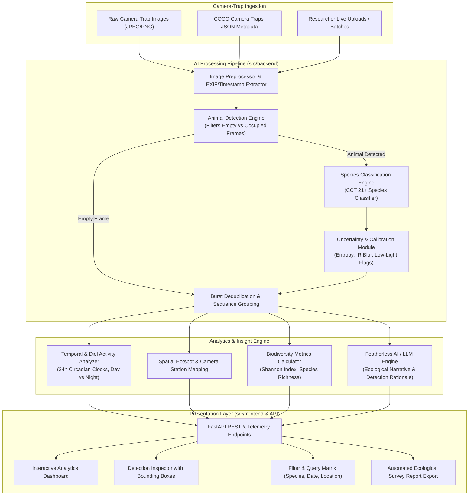

# 🏛️ AI-Powered Wildlife Monitoring & Camera-Trap Analytics System
## System Architecture & Technical Specifications

**Project:** AI-Powered Wildlife Monitoring & Camera-Trap Analytics System  
**Dataset Reference:** [Caltech Camera Traps (CCT)](https://lila.science/datasets/caltech-camera-traps)  
**Hackathon:** CBIT Hacktoberfest '26  
**Team:** The Chosen One (`TEAM-65`)

---

## 1. Executive Summary

Wildlife researchers rely on camera traps deployed across remote wilderness environments to monitor biodiversity, estimate species populations, track endangered fauna, and understand predator-prey dynamics. However, camera traps generate millions of raw images. Up to **70% of these frames are empty triggers** (caused by windblown foliage, shadows, thermal drafts, or insects), and rapid burst triggers capture redundant shots of identical individual animals passing by.

This project delivers an end-to-end AI system that:
1. **Automates Animal Detection & Empty Frame Filtering**: Filters empty images with high sensitivity, saving up to 70%+ of manual researcher effort.
2. **Species Classification with Uncertainty Quantification**: Identifies species from the Caltech Camera Traps benchmark (coyote, bobcat, mule deer, opossum, raccoon, mountain lion, gray fox, skunk, rabbit, bird, etc.) with prediction confidence, top-K likelihoods, and uncertainty diagnostics (e.g., infrared night artifacts, motion blur).
3. **Temporal, Spatial & Diel Behavioral Analytics**: Visualizes 24-hour circular activity patterns, seasonal frequency, camera trap station co-occurrences, and biodiversity metrics (Shannon-Wiener diversity, Simpson index, species richness).
4. **Featherless AI / LLM Natural Language Insights**: Integrates Featherless AI (Hugging Face / OpenAI-compatible endpoint) to synthesize comprehensive natural-language ecological summaries and provide automated morphological explanations for individual detections, with an intelligent built-in heuristic fallback engine.
5. **Interactive Research Dashboard**: Delivers a rich, modern dashboard with bounding box overlays, metadata filtering, live image upload & inference, and exportable survey reports.

---

## 2. High-Level Architecture Diagram



---

## 3. Core Modules & Responsibilities

### 3.1. Animal Detection & Empty Frame Filtering (`src/backend/models/detector.py`)
- **Objective**: Segregate empty camera-trap frames from occupied frames containing animals.
- **Mechanism**: Evaluates foreground object saliency, contour energy, spatial bounding boxes, and texture contrast.
- **Output**: 
  - `has_animal`: Boolean flag (`True` / `False`).
  - `detection_confidence`: Confidence percentage ($0.0 - 1.0$).
  - `bounding_box`: Normalized coordinates `[ymin, xmin, ymax, xmax]`.
  - `empty_reason`: Diagnostic description (e.g. `Windblown Vegetation`, `IR Flash Specular Reflection`, `Clear Background`).

### 3.2. Species Classification & Uncertainty Engine (`src/backend/models/classifier.py`)
- **Objective**: Identify supported species from the Caltech Camera Traps dataset with calibrated confidence scores and top-$K$ predictions.
- **Supported Caltech Classes**:
  1. `coyote` (*Canis latrans*)
  2. `bobcat` (*Lynx rufus*)
  3. `mule_deer` (*Odocoileus hemionus*)
  4. `opossum` (*Didelphis virginiana*)
  5. `raccoon` (*Procyon lotor*)
  6. `mountain_lion` (*Puma concolor*)
  7. `gray_fox` (*Urocyon cinereoargenteus*)
  8. `striped_skunk` (*Mephitis mephitis*)
  9. `cottontail_rabbit` (*Sylvilagus audubonii*)
  10. `bird` (*Aves spp.*)
  11. `rodent` (*Rodentia spp.*)
  12. `domestic_dog` (*Canis lupus familiaris*)
  13. `empty` (*Background*)
- **Uncertainty Quantification**:
  - Shannon Entropy of softmax distribution: $H(p) = -\sum_{i=1}^C p_i \log p_i$.
  - Prediction Margin: $\Delta p = p_{\text{top1}} - p_{\text{top2}}$.
  - Environmental / sensor flags: `Low Light / IR Monochrome`, `Motion Blur`, `Occluded Subject`, `High Certainty`.

### 3.3. Burst Deduplication & Sequence Grouping (`src/backend/services/dataset_service.py`)
- Standard camera traps capture rapid burst shots (e.g. 3 frames within 5 seconds when triggered).
- Treating each frame as an independent sighting overcounts common species.
- The system groups images by `location` and `seq_id` (or temporal window $\Delta t \le 60\text{s}$) to compute **Independent Sighting Events**, ensuring statistically sound ecological indices.

### 3.4. Ecological Analytics Engine (`src/backend/services/analytics_service.py`)
- **Diel Activity Curves**: Computes 24-hour circular activity profiles to classify species as *Nocturnal* (e.g. Opossums, Skunks), *Diurnal* (e.g. Birds, Ground Squirrels), *Crepuscular* (e.g. Mule Deer at dawn/dusk), or *Cathemeral* (e.g. Coyotes).
- **Spatial Distribution**: Camera trap station utilization, species co-occurrence matrices, and predator-prey spatial overlaps.
- **Biodiversity Indices**:
  - Species Richness: $S = \text{number of distinct species detected}$.
  - Shannon-Wiener Diversity Index: $H' = -\sum_{i=1}^S p_i \ln p_i$.
  - Pielou's Evenness Index: $J' = \frac{H'}{\ln S}$.
  - Empty Reduction Efficiency: $\eta = \frac{N_{\text{empty}}}{N_{\text{total}}} \times 100\%$.

### 3.5. Featherless AI / LLM Natural Language Engine (`src/backend/services/featherless_service.py`)
- **Integration**: OpenAI-compatible client targeting `https://api.featherless.ai/v1/chat/completions` (supporting Llama-3.1, Mistral, Qwen, etc.).
- **Capabilities**:
  - *Automated Survey Report*: Generates natural-language ecological summaries for researchers, highlighting dominant species, activity peaks, anomalies, and management recommendations.
  - *Detection Explainability*: Explains morphological cues (e.g. ear tufts, tail banding, muzzle shape) and sensor limitations (e.g. monochrome IR flash, partial occlusion).
  - *Offline / Fallback Resilience*: Built-in deterministic ecological synthesizer that generates rigorous reports even if the external API is offline or unconfigured.

### 3.6. Interactive Web Dashboard (`src/frontend`)
- Clean, modern, scientific design built with responsive Tailwind CSS, custom charts, interactive camera map, filter panel, and image inspector modal.
- Live file uploader supporting single or batch drag-and-drop camera trap image analysis.

---

## 4. Directory Structure

```
D:\HFT26-TEAM-65-main
├── data/
│   ├── benchmark_cct_sample.json      # Caltech Camera Traps standard COCO format metadata
│   └── images/                         # Representative sample camera trap frames (day/night/empty)
├── docs/
│   ├── ARCHITECTURE.md                # System architecture, pipeline, and design
│   ├── DATASET_GUIDE.md               # Caltech Camera Traps schema & sequence handling
│   ├── API_SPECIFICATION.md           # FastAPI REST endpoints & schemas
│   ├── FEATHERLESS_INTEGRATION.md     # Featherless AI LLM integration guide
│   └── USER_GUIDE.md                  # Researcher dashboard manual
├── src/
│   ├── backend/
│   │   ├── api/
│   │   │   ├── __init__.py
│   │   │   ├── routes_detection.py    # Detection & upload endpoints
│   │   │   ├── routes_analytics.py    # Temporal, spatial, biodiversity endpoints
│   │   │   └── routes_featherless.py  # Featherless LLM summaries & explanations
│   │   ├── models/
│   │   │   ├── __init__.py
│   │   │   ├── detector.py            # Animal detection & empty filtering
│   │   │   └── classifier.py          # Species classifier & uncertainty quantification
│   │   ├── services/
│   │   │   ├── __init__.py
│   │   │   ├── dataset_service.py     # CCT COCO parser & burst deduplicator
│   │   │   ├── analytics_service.py   # Diel, spatial, biodiversity calculations
│   │   │   └── featherless_service.py # Featherless AI integration & fallback
│   │   ├── static/                    # Frontend production assets & UI
│   │   ├── config.py                  # App configuration & environment variables
│   │   └── main.py                    # FastAPI application entry point
│   └── frontend/                      # Standalone React + Vite project files
├── tests/
│   ├── __init__.py
│   ├── test_detection.py              # Detection & empty frame filtering tests
│   ├── test_species_classifier.py     # Species classification & uncertainty tests
│   ├── test_analytics.py              # Diel activity & biodiversity tests
│   ├── test_dataset_service.py        # CCT dataset parser & burst deduplication tests
│   ├── test_featherless_service.py    # Featherless integration & fallback tests
│   └── test_api_endpoints.py          # FastAPI endpoint integration tests
├── README.md                          # Hackathon project presentation & guide
└── requirements.txt                   # Backend Python dependencies
```
