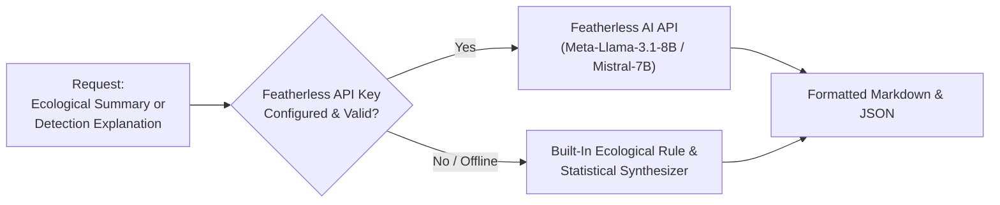

# 🪶 Featherless AI Integration & Prompt Engineering Guide

**Project:** AI-Powered Wildlife Monitoring & Camera-Trap Analytics System  
**Team:** The Chosen One (`TEAM-65`)

---

## 1. Why Featherless AI for Wildlife Monitoring?

Camera-trap analytics generate rich numerical telemetry (bounding boxes, confidence distributions, circular diel histograms, co-occurrence matrices). However, field researchers and wildlife management teams often need to:
1. **Quickly digest large surveillance periods**: "Did mountain lion activity increase near riparian corridors following the recent drought?"
2. **Interpret borderline / uncertain detections**: "Why was image `cct_img_420` classified as a Coyote with 62% confidence instead of a Domestic Dog or Gray Fox?"
3. **Generate formal stakeholder reports**: Natural-language ecological summaries for state parks, conservation reserves, and peer-reviewed studies.

**Featherless AI** provides serverless access to open-weight LLMs (such as `meta-llama/Meta-Llama-3.1-8B-Instruct`, `mistralai/Mistral-7B-Instruct-v0.3`, and `Qwen/Qwen2.5-7B-Instruct`) through an OpenAI-compatible API.

---

## 2. Architecture & Fallback Strategy

To ensure 100% testability, zero downtime, and seamless evaluation out-of-the-box (even without an internet connection or before an API key is entered), the system uses a **Dual-Mode Engine**:



### Key Highlights:
1. **Zero Configuration Barrier**: The application works immediately out-of-the-box with rich statistical narrative generation.
2. **Live Featherless API Support**: Simply set `FEATHERLESS_API_KEY` in environment variables or enter it via the dashboard settings dialog to enable live LLM generation.
3. **Full OpenAI Compatibility**: Uses standard `POST https://api.featherless.ai/v1/chat/completions` schema with `temperature`, `system`, and `user` messages.

---

## 3. Core Prompts & Workflows

### 3.1. Ecological Survey Summary Prompt
```text
System: You are an expert wildlife ecologist and camera-trap analytics specialist. 
Synthesize quantitative monitoring data into clear, scientific, actionable executive findings.

User:
Here is the camera-trap telemetry for the monitored period:
- Total Images Evaluated: {total_images}
- Empty Frames Filtered: {empty_count} ({empty_pct}%)
- Independent Wildlife Sightings: {independent_events}
- Species Richness: {species_richness}
- Shannon-Wiener Diversity Index: {shannon_index:.2f}
- Top Species Observed: {species_counts}
- Diel Activity Tendencies: {diel_summary}
- Camera Station Hotspots: {hotspots}
- Low Confidence / Flagged Detections: {uncertainty_summary}

Please provide:
1. Executive Wildlife Assessment
2. Diel & Temporal Activity Patterns
3. Spatial Hotspots & Habitat Usage
4. Data Limitations & Uncertain Detections
5. Conservation & Monitoring Recommendations
```

### 3.2. Detection Explainability Prompt
```text
System: You are a computer vision specialist in wildlife biology. 
Explain species classification results by referencing diagnostic morphological features, 
illumination type (daylight vs IR night vision), and image quality.

User:
Image ID: {image_id}
Predicted Class: {species} ({confidence:.1%})
Top Candidates: {top_k}
Uncertainty Score: {uncertainty_score}
Environmental Flags: {flags}

Explain why this detection was classified as {species}, what distinguishing field marks 
support the decision, and how data limitations (like IR flash or motion blur) affect certainty.
```

---

## 4. Configuration & Testing

To set your Featherless AI API key:

### Via Environment Variable:
```bash
set FEATHERLESS_API_KEY=your_featherless_api_key_here
set FEATHERLESS_MODEL=meta-llama/Meta-Llama-3.1-8B-Instruct
```

### Via Interactive Dashboard:
Click the **Settings / Featherless Key** button in the dashboard top navigation bar, paste your API key, and click **Save**. The dashboard validates the connection instantly.
